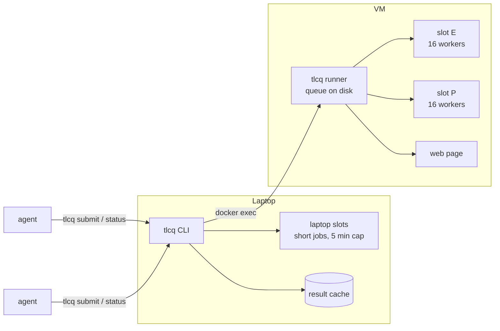

# tlcq

**A shared queue for TLA+ model checking, built for AI coding agents.**

[](https://github.com/martynovs/tlcq/actions/workflows/ci.yml)
[](LICENSE)
[](Cargo.toml)
[](#engines)

Several agents working on TLA+ specs at once will each start TLC whenever
they like: on the same laptop, on the same configuration, with no idea how
long a run will take. tlcq gives them one command to submit model-checking
jobs and one to poll them. It decides where each job runs, runs it, caches
the result, and reports back to the agent that asked.

```console
$ tlcq submit specs/consensus
Consensus.cfg       3f2a91c07d1e  laptop l1                  (tlx, short, from its history)
Consensus_live.cfg  8b04e6d2a9f3  vm v1 started in E         (tlx, long, from its history)
Consensus_bug.cfg   c71d5e0b8a42  cached: ok, 6 distinct states, 5s on vm  (tlx)

$ tlcq status
Consensus_live.cfg  8b04e6d2a9f3  v1  running on vm E for 12m (since 09:14 UTC), 41M distinct, ...; cap 2h00m
```

## Features

- **Placement by expected length.** Short jobs run on the laptop in a limited
  number of slots under a 5-minute cap; long and unknown ones queue on a
  dedicated VM. The expected length comes from a flag, a name suffix, or the
  configuration's history.
- **Content-addressed cache.** A job's id hashes the spec, its modules, the
  configuration, the options and the engine version. Submitting an unchanged
  job answers at once, whichever agent ran it.
- **Per-agent reporting.** `tlcq status` reports the jobs of the calling agent
  (its git worktree, plus `$TLCQ_AGENT`), across restarts of either side.
- **A VM runner with pinned slots.** Two 16-worker slots pinned to the CPU's
  core types, time caps by lane, a size probe that promotes big jobs, and an
  ETA learned from earlier runs.
- **Pause and resume.** Long jobs stop at an engine checkpoint and resume
  later, across restarts and reboots. Freeze frees a slot instantly.
- **A web page** for humans: slots, queue, progress charts, logs, and the
  controls (freeze, pause, keep running, resume, reorder, cancel, hold).
- **Two engines.** [tlx](https://github.com/tlaplus-x/tlx), a compiled Rust
  rewrite of TLC, by default; TLC itself on request.
- **Model-checked design.** The placement protocol and the runner are TLA+
  models in [`tla/`](tla), with must-fail variants for every race found.

## How it works



The CLI talks to the runner through `docker --context <vm> exec`, so the VM
needs nothing but a container engine. The runner keeps its queue on a
volume and starts each attempt in a container of its own, so running jobs
outlive a runner restart.

## Quick start

Requirements: a Rust toolchain, [just](https://github.com/casey/just), Java
for TLC runs, and on the VM, Docker or rootless podman.

```sh
git clone https://github.com/martynovs/tlcq && cd tlcq
just install            # tlcq into ~/.cargo/bin, tlx at the pinned rev
mkdir -p ~/.local/share/tlcq/jars
cp /path/to/tla2tools.jar /path/to/CommunityModules-deps.jar ~/.local/share/tlcq/jars/
```

Then, from a git worktree with a TLA+ model directory:

```sh
tlcq submit specs/consensus                 # every configuration but max ones
tlcq submit specs/consensus Consensus.cfg   # just one
tlcq status                                 # this agent's current jobs
tlcq ls                                     # every job, on both machines
tlcq cancel 3f2a91c07d1e                    # also drops a paused run's checkpoint
tlcq resume 3f2a91c07d1e --memory 110G      # a paused run, from its checkpoint
tlcq fetch 3f2a91c07d1e                     # logs and result.json into ./tmp/tlcq/
```

Without a VM, `tlcq submit --local` runs everything on the laptop, uncapped.

## Configuration

A model directory can hold a `tlcq.toml` with its defaults:

```toml
spec = "Consensus"
extends = ["../common"]      # other directories whose modules the spec uses
cfgs = [
  "Consensus.cfg",
  { name = "Consensus_bug.cfg", must_fail_only = true },
  { name = "Consensus_max.cfg", timeout = "24h" },
  { name = "Consensus_live.cfg", engine = "tlc" },
  { name = "Consensus_live_max.cfg", memory = "64G" },
]
```

- **`must fail`.** A configuration whose header says `\* … must fail <Property>`
  (or `must fail deadlock`) passes only when the engine reports that violation.
- **Expected length.** `--fast`, `--slow` or `--max`, or a `_fast`, `_slow`,
  `_max` name suffix; otherwise it comes from earlier runs.
- **Memory.** `memory = "64G"` or `--memory 64G` (`M`, `G`, `T`; a bare number is
  MB) is the least memory a VM attempt starts with. Ask for it only once a run's
  status says `needs more memory: resubmit with --memory <G>`: the request waits
  for a slot with that much free. Above one slot's share it takes the whole VM,
  running in E alone with the P slot kept empty until it ends or pauses. A job
  with a request never runs on the laptop, and its id is unchanged, so a run
  that ended for lack of memory reruns with it.
- **Flags win.** A command-line flag (`--engine`, `--timeout`, `--max`, ...)
  overrides every configuration's entry.
- **Exit codes.** `submit` exits 0 when every job is placed, 2 on a refusal or
  usage error, 3 when the VM's answer is unknown. `status` exits 0 while jobs
  run or pass, 1 when one ends unexpected, 3 on a timeout, cancel or error.

Machine settings are flags, `TLCQ_*` variables, or `~/.config/tlcq/config.toml`
(keys are the variable names in lower case without the prefix):

```toml
context = "pve"        # the docker context the runner is in
slots = 1              # laptop jobs that run at once
deadline_secs = 120    # the deadline of one VM call
```

## Engines

tlx reads the same `.tla` and `.cfg` files, gives the same verdicts, and runs
most configurations several times faster. The engine is `--engine tlc|tlx`,
else the configuration's `engine`, else the directory's, else tlx. Prefer TLC
for a `must fail` on a temporal property (TLC stops at the first violation,
tlx checks liveness after the whole search), for a spec tlx refuses, or to
double-check a surprising result.

The engine version is part of a job's id, so the laptop and the VM must run
the same one: `tlx.rev` pins tlx, built from the repository `tlx.repo` names.
That is currently a fork's [`tlcq` branch](https://github.com/martynovs/tlx/tree/tlcq),
carrying six fixes:

- [one](https://github.com/tlaplus-x/tlx/pull/1) keeps a resumed run from
  loading its whole checkpointed queue into memory at once (84 GB for a
  26M-state queue);
- [one](https://github.com/tlaplus-x/tlx/pull/2) keeps the liveness check of
  a graph past 2^26 states from slowing to days in a hash map whose keys all
  landed in the same few buckets;
- [one](https://github.com/tlaplus-x/tlx/pull/3) lets a run recovered from a
  checkpoint taken after a layout miss check liveness at all;
- [one](https://github.com/tlaplus-x/tlx/pull/4) stops a run whose memory
  grows past `-maxmem` (symmetry with several workers) before the kernel
  kills it, saying so and keeping its last checkpoint;
- [one](https://github.com/tlaplus-x/tlx/pull/5) has the first checkpoint
  after a recovery link what it recovered instead of writing it all again
  (a disk-full failure on a 1.47B-state run);
- [one](https://github.com/tlaplus-x/tlx/pull/6) keeps the `_POSSIBLE`
  predicates a run witnessed before its checkpoint witnessed once it is
  recovered (a recovered run failed "never witnessed").

It goes back to upstream once they are merged.

## The VM runner

```sh
just docker-jars ~/.local/share/tlcq/jars   # the same TLC jars into the image
just docker-pve                             # build on the VM and (re)start the runner
just docker-up                              # or: a local runner in Docker Desktop
```

The runner is a compose service, `tlcq-runner`, with its state in the
`tlcq-state` volume. `docker/compose.yaml` is the base; `docker/compose.pve.yaml`
adds a restart policy and reverse-proxy labels for the page. A local runner's
page is at <http://localhost:8080>.

**Slots.** E (CPUs 16–31) and P (CPUs 0–15) each run one job with 16
workers and half the memory left after a reserve; E fills first. Side by side
they do about 1.6× the work of one job on the whole machine. The P slot can
be closed from the page to give the cores back to the host's other VMs.
`TLCQ_E_CPUS` and `TLCQ_P_CPUS` set the CPU lists.

**Lanes.** A job runs under a 2-hour cap; a probe of its queue growth at 15
minutes promotes a big one to the max lane and a 12-hour cap, in place.

**Disk.** No job starts while the state volume has less free than
`TLCQ_DISK_FLOOR_GB` (default 20). A big tlx run spills its fingerprints,
queue and archive there (one used 222 GB). Below twice the floor, the runner
deletes the scratch and checkpoints no recorded run owns and prunes untagged
unused images, every minute, and `tlcq status` warns. The page shows free
disk and memory and each running job's scratch.

**Deaths.** A run an hour or more in whose engine dies with no verdict
(killed for memory, a reboot), with an error, or at its time cap keeps its checkpoint and stays
paused: `tlcq status` says why, how much memory to ask for when it ran out
(or `--timeout` for a longer cap),
and what its checkpoint holds on disk, and lists every checkpoint the agent's
paused runs keep. The agent decides: `tlcq resume <id> --memory <G>` recovers
it, `tlcq cancel <id>` (or `submit --replace` of a new version) drops it and
its checkpoint.

**Controls**, from the page:

| Control | Effect |
|---|---|
| Freeze | Pauses the job's container at once; its slot frees, its memory stays. It stays frozen until unfrozen (it then takes the next free slot) or paused. |
| Pause | Stops the job at its next checkpoint (every 10 minutes) and keeps the checkpoint, a tlx one with the tlx binary that wrote it, so it survives a deploy of a newer tlx; the run holds no slot or memory and survives reboots. |
| Keep running | Withdraws a pause before it lands. |
| Resume | Puts a paused run first in the queue; it recovers its checkpoint in whichever slot frees. A resume that dies, or whose engine refuses the checkpoint, leaves it paused again, with the reason. |
| Hold queue | Starts nothing new until released; running jobs go on. |

## Development

```sh
just test         # cargo nextest
just clippy       # pedantic + strict lints
just gate         # CRAP score, a 90% per-function coverage floor, the docs build
just fmt          # rustfmt, last
just ui-dev       # the page with live reload
just ui-check     # type-check the page
```

The gate needs `cargo install cargo-nextest cargo-llvm-cov cargo-crap`; the
page needs Node and pnpm. [`CLAUDE.md`](CLAUDE.md) has the workflow and
conventions.

The behaviour is specified in [`openspec/specs/`](openspec/specs), with the
design decisions of each change in [`openspec/changes/archive/`](openspec/changes/archive).
The TLA+ models in [`tla/placement`](tla/placement) and [`tla/runner`](tla/runner)
can be checked with tlcq itself: `tlcq submit tla/runner`.

## License

[MIT](LICENSE)
